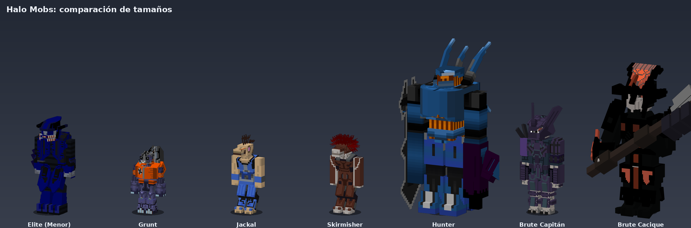
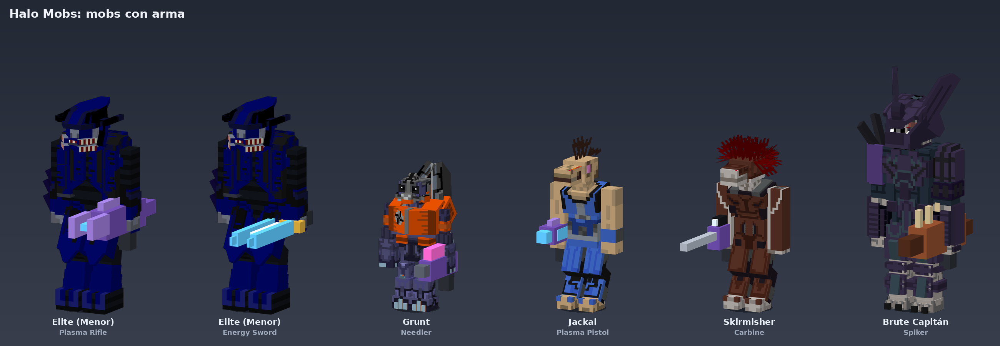
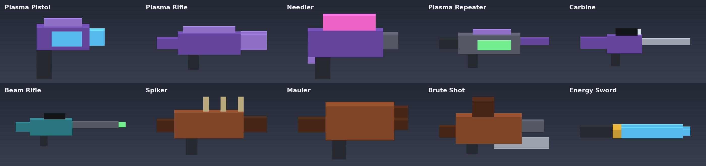

# Halo Mobs (Forge 1.20.1)

Mobs del Covenant para Minecraft Java 1.20.1 (Forge 47.x) usando [GeckoLib 4](https://github.com/bernie-ecosystem/GeckoLib), portados desde assets de un addon Bedrock.

## Mobs
Modelos, texturas y animaciones **originales del addon Bedrock "Halocraft"** (resource pack `halocraftr`), portados con GeckoLib.

| Mob | ID | Textura |
|---|---|---|
| Elite (Menor) | `halomobs:elite` | halo_elite_menor |
| Grunt | `halomobs:grunt` | halo_grunt_menor |
| Jackal | `halomobs:jackal` | halo_jackals |
| Skirmisher | `halomobs:skirmisher` | halo_skimisher |
| Hunter | `halomobs:hunter` | halo_hunter |
| Brute Capitán | `halomobs:brute_capitan` | halo_brute_menor |
| Brute Cacique | `halomobs:brute_cacique` | halo_brute_cacique |

Cada mob tiene huevo generador en la pestaña creativa **Halo Mobs**. Son hostiles hacia jugadores.
Animaciones: idle, caminar, correr, ataque y muerte (los clips del addon, ya convertidos).
Los ojos y partes de energía brillan (`<mob>_glowmask.png`, sacado del mapa emisivo del addon).



## Armas (v0.3.0)
Los mobs ahora salen **armados** (el arma se elige al aparecer según su tabla, se guarda en el NBT y se ve en su mano):

| Mob | Armas posibles |
|---|---|
| Elite | Plasma Rifle, Needler, Plasma Repeater, Carbine, Plasma Pistol, Energy Sword (melee) |
| Grunt | Plasma Pistol, Needler |
| Jackal | Plasma Pistol, Needler |
| Skirmisher | Carbine, Needler, Beam Rifle |
| Hunter | Fuel Rod (el cañón ya es parte del modelo, sin item) |
| Brute Capitán | Spiker, Mauler, Brute Shot, Plasma Rifle, Carbine |
| Brute Cacique | solo melee (martillo del modelo) |

- Disparan **ráfagas** (`burst_shots`/`burst_interval`/`attack_interval` del addon), mantienen distancia, retroceden y hacen strafe.
- Elite, Grunt y Brute Capitán lanzan **granadas de plasma** de vez en cuando (explosión sin romper bloques).
- Sin fuego amigo entre mobs Halo. Al morir sueltan su arma con ~12 % (+3 % por nivel de Looting).
- Las armas también son items (pestaña **Halo Mobs**): clic derecho dispara, munición infinita; la Energy Sword es una espada.
- Todos los números salen del behavior pack `halocraftb` (`entities/balas`, `entities/covenant`). El daño de Bedrock se multiplica por `HaloWeapon.DAMAGE_SCALE` (0.22): cámbialo para balancear todo de golpe.




**Los modelos de las armas son de cajas propias (marcador de posición).** `halocraftb` es solo el behavior pack: los
modelos y texturas originales de las armas están en el resource pack del addon (`halocraftr`, attachables), que no se usó.

## Herramientas (`tools/`)
- `gen_weapons.py`: genera los modelos de las armas (`models/item`), la paleta, la textura del proyectil y los textos.
- `preview_weapons.py`: previews de mobs con arma y catálogo (`previews/armas_*.png`).
- `import_halocraftr.py <carpeta halocraftr>`: copia modelos, texturas y animaciones del addon al mod (evalúa las expresiones Molang a valores fijos).
- `preview.py`: genera las imágenes de `previews/` (`pip install pillow numpy`).

## Pendiente / no portado
- Sonidos (`mob.halo_*`: ahora se usan sonidos vanilla como marcador), escudos y variantes de textura (Jackal mayor/franco, Hunter 3, etc.).
- Modelos originales de las armas (attachables de `halocraftr`) y la pose de apuntar (`armauno_*`): el arma cuelga de la mano en reposo.
- Habilidades del addon sin portar: bloqueo/escudo, dash del Elite, Grunt kamikaze, Brute "rabioso", salto del Cacique.
- Las animaciones usan los valores fijos de las expresiones Molang (el seguimiento de la mirada y el balanceo dependiente del objetivo no se portaron).
- Spawn natural: por ahora solo con huevos o `/summon halomobs:elite`.

## Compilar
Requiere Java 17.
```
gradle build      # o ./gradlew build si generas el wrapper con: gradle wrapper --gradle-version 8.1.1
```
El .jar queda en `build/libs/`. Para probar: `gradle runClient`.
GitHub Actions (`.github/workflows/build.yml`) compila en cada push y sube el .jar como artefacto.

## Licencia
Halo es propiedad de Microsoft/343 Industries. Proyecto fan sin fines de lucro; revisa los derechos de los assets originales antes de publicar.
